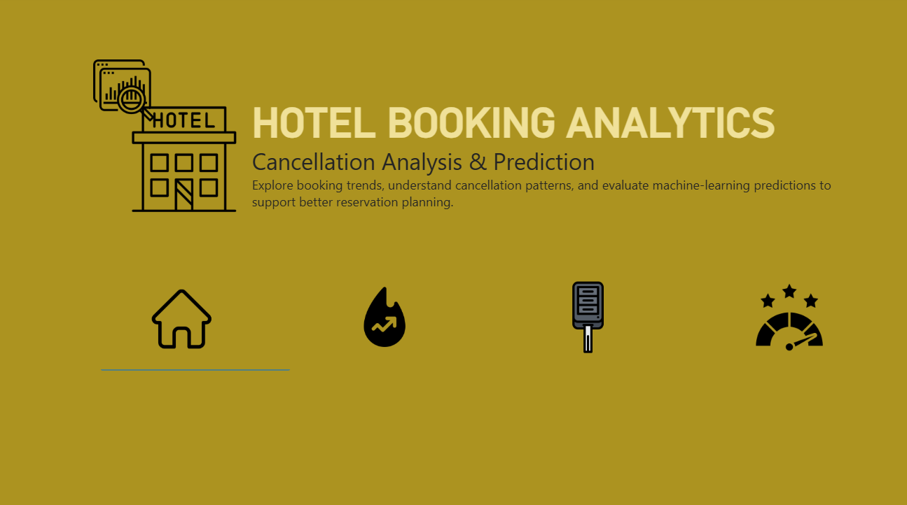
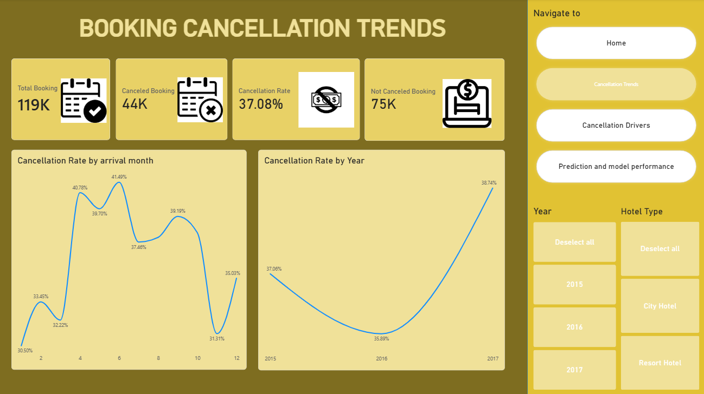
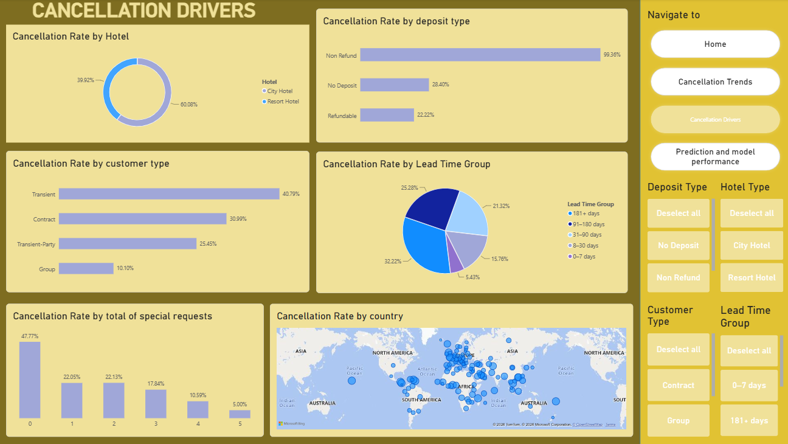
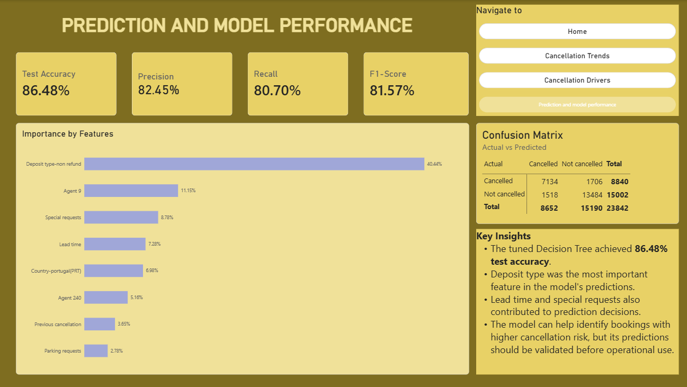

# 🏨 Hotel Booking Cancellation Analysis & Prediction

An end-to-end Data Analytics and Machine Learning project that analyzes hotel booking patterns, identifies factors influencing cancellations, and predicts booking cancellations using classification algorithms. The project also includes an interactive Power BI dashboard for business insights and model performance evaluation.

---

## 📌 Project Overview

Hotel booking cancellations can affect room availability, revenue planning, and hotel operations.

This project uses historical booking data from City Hotels and Resort Hotels to understand cancellation behavior, identify important cancellation drivers, and develop machine learning models to predict whether a hotel reservation is likely to be canceled.

The project combines Python, Exploratory Data Analysis (EDA), Machine Learning, and Power BI to transform booking data into meaningful business insights.

## 🎯 Business Objectives

- Analyze hotel booking and cancellation patterns.
- Identify the key factors associated with booking cancellations.
- Understand the impact of deposit type and lead time on cancellations.
- Compare cancellation patterns across different customer and hotel categories.
- Build and evaluate machine learning classification models.
- Develop an interactive Power BI dashboard.
- Generate business insights to support hotel reservation planning.

## 📊 Dataset Information

- **Dataset:** Hotel Booking Demand
- **Source:** Kaggle
- **Original Records:** 119,390
- **Records After Cleaning:** 119,210
- **Original Features:** 36
- **Target Variable:** `is_canceled`

The dataset contains historical hotel reservation information, including booking dates, customer details, deposit types, market segments, room information, and cancellation status.

### Target Variable

| Value | Description |
|---|---|
| 0 | Booking not canceled |
| 1 | Booking canceled |

Dataset source: Kaggle – Hotel Booking Demand Dataset.

## 🛠️ Tools & Technologies

| Technology | Purpose |
|---|---|
| Python | Data analysis and preprocessing |
| Pandas | Data manipulation and cleaning |
| NumPy | Numerical operations |
| Matplotlib | Data visualization |
| Seaborn | Statistical visualization |
| Scikit-learn | Machine learning |
| Jupyter Notebook | Analysis and model development |
| Power BI | Interactive dashboards |
| Joblib | Model serialization |

## 🔄 Project Workflow

### 1. Data Loading and Exploration

- Loaded the hotel booking dataset using Pandas.
- Examined dataset dimensions, column information, and data types.
- Analyzed descriptive statistics and unique values.
- Checked missing values and duplicate records.
- Studied the distribution of the target variable.

### 2. Data Cleaning and Preprocessing

- Identified missing values in Company, Agent, Country, and Children columns.
- Replaced missing Company values with `No company`.
- Replaced missing Agent values with `No agent`.
- Replaced missing Country values with `Unknown`.
- Filled missing Children values with zero.
- Removed bookings with no adults, children, or babies.
- Removed records with negative ADR values and ADR values above 1000.
- Converted Children into an integer data type.
- Converted reservation status date into datetime format.
- Removed personal information columns such as Name, Email, Phone Number, and Credit Card.
- Removed Reservation Status and Reservation Status Date from the analytical dataset.

### 3. Feature Engineering

Created additional features to support deeper analysis:

| Feature | Description |
|---|---|
| `total_night_stay` | Total weekend and weekday nights |
| `total_guests` | Total adults, children, and babies |
| `room_type_changed` | Identifies whether the assigned room differed from the reserved room |
| `lead_time_group` | Groups bookings by advance booking duration |
| `previous_cancel_group` | Groups customers by previous cancellation history |
| `has_parking_request` | Indicates whether a parking space was requested |
| `has_booking_changes` | Indicates whether a booking was modified |
| `waiting_days_group` | Groups bookings by waiting-list duration |

### 4. Exploratory Data Analysis (EDA)

Analyzed booking cancellation behavior across different booking characteristics.

Key areas explored:

- Overall booking and cancellation distribution.
- Cancellation patterns by hotel type.
- Cancellation rates by deposit type.
- Cancellation rates by customer type.
- Cancellation rates by lead time group.
- Cancellation patterns by market segment.
- Previous cancellation history.
- Special requests and parking requirements.
- Average Daily Rate (ADR).
- Waiting-list duration.
- Monthly booking cancellation trends.

### 5. Machine Learning Model Development

Developed four classification models to predict hotel booking cancellations.

**Algorithms used:**

1. Logistic Regression
2. Decision Tree Classifier
3. Random Forest Classifier
4. Hyperparameter-tuned Decision Tree Classifier

**Preprocessing techniques:**

- 80:20 train-test split.
- Stratified sampling.
- StandardScaler for numerical features.
- OneHotEncoder for categorical features.
- ColumnTransformer for combined preprocessing.
- GridSearchCV for hyperparameter tuning.

**Hyperparameter tuning:**

GridSearchCV was used with 3-fold cross-validation and F1-score as the scoring metric.

Best parameters:

- `max_depth = 20`
- `min_samples_split = 2`
- `min_samples_leaf = 1`

### 6. Model Evaluation

Models were evaluated using:

- Accuracy
- Precision
- Recall
- F1-score
- ROC-AUC
- Confusion Matrix

#### Model Performance Comparison

| Model | Accuracy | Precision | Recall | F1-score | ROC-AUC |
|---|---:|---:|---:|---:|---:|
| Logistic Regression | 82.44% | 80.95% | 68.85% | 74.41% | 90.79% |
| Decision Tree | 84.85% | 82.46% | 75.11% | 78.62% | 92.75% |
| Tuned Decision Tree | **86.48%** | 82.45% | **80.70%** | **81.57%** | 89.37% |
| Random Forest | 76.97% | 99.73% | 38.00% | 55.03% | 91.11% |

**Selected Model: Tuned Decision Tree Classifier**

The tuned Decision Tree achieved the highest accuracy and F1-score among the four evaluated models.

#### Confusion Matrix

| Actual / Predicted | Canceled | Not Canceled |
|---|---:|---:|
| Canceled | 7,134 | 1,706 |
| Not Canceled | 1,518 | 13,484 |

The final preprocessing and classification pipeline was saved using Joblib as `hotel_cancellation_model.pkl`.

### 7. Power BI Dashboard

Developed a four-page interactive Power BI dashboard to present booking trends, cancellation drivers, and machine learning performance.

**Page 1 – Home**
- Project introduction.
- Dashboard navigation.

**Page 2 – Booking Cancellation Trends**
- Total bookings: 119K.
- Canceled bookings: 44K.
- Cancellation rate: 37.08%.
- Non-canceled bookings: 75K.
- Monthly cancellation trends.
- Yearly cancellation trends.
- Year and hotel type filters.

**Page 3 – Cancellation Drivers**
- Cancellation rate by hotel type.
- Cancellation rate by deposit type.
- Cancellation rate by customer type.
- Cancellation rate by lead time group.
- Cancellation rate by number of special requests.
- Cancellation rate by country.
- Interactive slicers for filtering the analysis.

**Page 4 – Prediction and Model Performance**
- Test accuracy: 86.48%.
- Precision: 82.45%.
- Recall: 80.70%.
- F1-score: 81.57%.
- Feature importance analysis.
- Confusion matrix.
- Key model insights.

## 🖥️ Dashboard Preview

### Home Page



### Booking Cancellation Trends



### Cancellation Drivers



### Prediction and Model Performance



## 🔍 Key Business Insights

1. Approximately 37.08% of hotel bookings were canceled.
2. Non-refundable deposit bookings showed an extremely high cancellation rate of approximately 99.36%.
3. Longer booking lead times were associated with higher cancellation rates.
4. Transient customers showed a higher cancellation rate than other customer categories.
5. Bookings with more special requests generally showed lower cancellation rates.
6. Deposit type was the most important feature in the tuned Decision Tree model.

## 💡 Business Recommendations

- Monitor bookings made far in advance to identify potential cancellation risks.
- Review deposit and reservation policies.
- Analyze customer segments to develop targeted retention strategies.
- Use cancellation predictions as an additional input for reservation planning.
- Monitor cancellation patterns through interactive dashboards.
- Use booking trends to support better operational and revenue planning.

## 📁 Project Files

| File | Description |
|---|---|
| `Hotel_booking.ipynb` | Complete data analysis and machine learning workflow |
| `hotel_cancellation_cleaned.csv` | Cleaned hotel booking dataset |
| `hotel_cancellation_model.pkl` | Saved machine learning pipeline |
| `hotel_booking_dashboard.pbix` | Interactive Power BI dashboard |
| `home.png` | Dashboard home page |
| `cancellation_trends.png` | Cancellation trends page |
| `cancellation_drivers.png` | Cancellation drivers page |
| `model_performance.png` | Model performance page |
| `requirements.txt` | Python dependencies |

## ⚙️ How to Run the Project

### 1. Clone the repository

```bash
git clone https://github.com/kirana-23/hotel-booking-cancellation-analysis.git
```

### 2. Navigate to the project directory

```bash
cd hotel-booking-cancellation-analysis
```

### 3. Create a virtual environment

```bash
python -m venv venv
```

### 4. Activate the environment

Windows:

```bash
venv\Scripts\activate
```

### 5. Install dependencies

```bash
pip install -r requirements.txt
```

### 6. Launch Jupyter Notebook

```bash
jupyter notebook
```

Open `Hotel_booking.ipynb` and run the notebook.

**Note:** The notebook requires the original Kaggle dataset to reproduce the complete workflow. Download the raw CSV separately and update the notebook's dataset path to match its location. The cleaned CSV is provided separately for reference.

## 🚀 Future Enhancements

- Develop a Streamlit application for interactive cancellation predictions.
- Experiment with additional classification algorithms.
- Improve model generalization through further feature engineering and validation.
- Integrate automated reporting and dashboard refresh.
- Deploy the trained model as a prediction service.

## ⚠️ Limitations

- The model is trained using historical booking data.
- Predictions may not fully represent future booking behavior.
- Model performance should be validated before operational use.
- Predictions should support, rather than replace, hotel reservation decisions.

## 👩‍💻 Author

**Kirana B**

Data Analytics | Python | SQL | Power BI | Excel | Machine Learning

GitHub: [kirana-23](https://github.com/kirana-23)

---

⭐ If you find this project useful, feel free to explore the repository!
